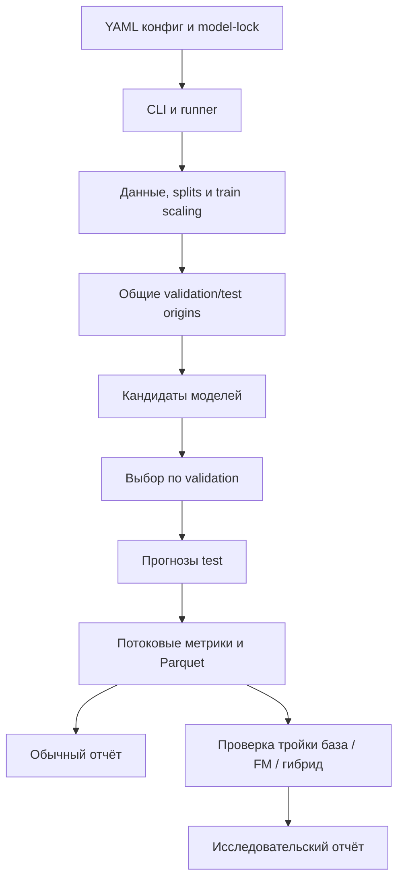

# Описание проекта и разбор реализации

Состояние: **26 октября 2026 года**. Документ объясняет, что сделано, как проходит
эксперимент и где находится соответствующий код. Команды установки и запуска
собраны отдельно в [RUN_GUIDE.md](RUN_GUIDE.md). Научная постановка и оставшаяся
работа разобраны в [SUPERVISOR_TASK_REVIEW.md](SUPERVISOR_TASK_REVIEW.md).

## 1. Назначение

`time-series-hybrid` — исследовательский Python-проект для проверки схемы:

\[
\hat y_{t+h}=\hat y^{base}_{t+h}+\hat r^{FM}_{t+h}.
\]

Статистическая модель строит базовый прогноз, а замороженная фундаментальная
модель прогнозирует остаточную компоненту. Главный практический вопрос первого
этапа: как этот гибрид сравнивается с базой и с FM на исходном ряде.

Результат проекта сейчас — запускаемый экспериментальный контур и первые
измерения. Критерий автоматического выбора коррекции, полноценная репликация всех
статей и доказательство научной новизны пока не реализованы.

## 2. Архитектура



Модельные классы отделены от формирования окон и подсчёта метрик. Поэтому ARIMA,
DLinear и FM можно оценивать по одним targets, сохраняя различия их обучения.

## 3. Карта файлов

| Файл или каталог | Назначение |
|---|---|
| [pyproject.toml](pyproject.toml) | Пакет, зависимости, extras, команда `tsh`, настройки тестов/Ruff |
| [src/tshybrid/cli.py](src/tshybrid/cli.py) | Все команды терминала |
| [src/tshybrid/runner.py](src/tshybrid/runner.py) | Конфиги, фабрика моделей, выбор кандидатов, запуски, provenance |
| [src/tshybrid/data.py](src/tshybrid/data.py) | Данные, нормализация, origins, ленивые окна |
| [src/tshybrid/models/base.py](src/tshybrid/models/base.py) | Контракт `Model`/`Forecast` |
| [src/tshybrid/models/statistical.py](src/tshybrid/models/statistical.py) | LastValue, SeasonalNaive, AR, ARIMA, ETS |
| [src/tshybrid/models/neural.py](src/tshybrid/models/neural.py) | Linear/DLinear, RevIN и обучение |
| [src/tshybrid/models/foundation.py](src/tshybrid/models/foundation.py) | Адаптеры Chronos, TimesFM, Moirai |
| [src/tshybrid/models/hybrid.py](src/tshybrid/models/hybrid.py) | Базовый прогноз плюс прогноз остатков |
| [src/tshybrid/evaluation.py](src/tshybrid/evaluation.py) | Метрики, батчи оценки, запись прогнозов |
| [src/tshybrid/reporting.py](src/tshybrid/reporting.py) | HTML одного запуска, сравнение эталонов, объединение запусков |
| [src/tshybrid/study.py](src/tshybrid/study.py) | Сопоставление трёх вариантов и исследовательский отчёт |
| [scripts/run_hybrid_study.py](scripts/run_hybrid_study.py) | Последовательный запуск двух окружений и отчёта |
| [configs/](configs/) | Проверочные, пилотные, полные и воспроизводящие конфиги |
| [references/](references/) | Авторские и опубликованные эталоны |
| [tests/test_protocol.py](tests/test_protocol.py) | Протокол, обучение, метрики и объединение запусков |
| [tests/test_study.py](tests/test_study.py) | Компоненты гибрида, paired-проверки и численный отказ кандидата |
| [reports/](reports/) | Компактные отчёты для чтения и ревью |
| `outputs/` | Полные артефакты конкретных запусков, исключены из git |

## 4. Что сделано по первоначальным шести пунктам

| Пункт | Реализация | Фактическое состояние |
|---|---|---|
| 1. Датасеты и эталоны | `cli.prepare_data`, `data.load_dataset`, `references/` | Три набора используются; есть SHA и эталоны DLinear |
| 2. Общий протокол | `data.make_origins`, конфиги, ветка `hn_mvts_code` | Общая оценка отделена от воспроизведения |
| 3. Evaluator | `evaluation.evaluate`, `Scores`, `prediction_frame` | Работает для всех подключённых моделей |
| 4. Модели и воспроизведение | `models/`, `runner.make_model`, `compare_references` | Бейзлайны и три FM проверены; один DLinear-run воспроизведён |
| 5. Простой гибрид | `Hybrid`, `ARIMA.components`, `hybrid_*.yaml` | Проверены три FM-корректора |
| 6. Первый отчёт | `study_report`, `paired_predictions`, `reports/hybrid_study/` | Есть 18 сравнений тройками и диагностика проблем |

Под «реализованным пунктом» здесь понимается наличие работающего кода и указанных
проверок. Это не означает завершение всех возможных benchmark-матриц.

## 5. Загрузка и подготовка данных

### 5.1. `load_dataset()`

Функция из `data.py`:

1. Разрешает путь относительно YAML.
2. Загружает NPY или CSV.
3. Применяет `take_n` и список каналов.
4. Проверяет конечность значений; у CSV проверяет timestamps при их наличии.
5. Вычисляет хронологические границы train/validation/test.
6. По train считает mean/std и сезонный масштаб MASE.
7. Возвращает `SeriesData` и manifest подготовки.

Фрагмент нормализации:

```python
mean = raw[:train_end].mean(axis=0)
scale = raw[:train_end].std(axis=0)
scale = np.where(scale < 1e-12, 1.0, scale)
values = ((raw - mean) / scale).astype(np.float32)
```

`axis=0` означает отдельные параметры каждого канала. Validation и test используют
уже рассчитанные train-параметры. Замена маленького scale на 1 защищает постоянные
каналы от деления на ноль. Нормализованные данные хранятся в float32, исходная
рабочая матрица — float64; при вычислении метрик используется float64.

В manifest записываются SHA исходного файла, использованные размеры, каналы,
границы split, mean/std и MASE scale. Это позволяет отличать одинаковое название
датасета от действительно одинакового экспериментального входа.

### 5.2. Ограничения loader

Нет автоматической импутации, ресемплинга, восстановления дат NPY, загрузчика
разнодлинных коллекций M4 и специализированного Monash loader. Названия каналов
NPY — строковые индексы. Их предметный смысл не восстанавливается автоматически.
`frequency` в YAML — метаданные; сезонность задаётся отдельным целым числом.

## 6. Origins и ленивые окна

Origin `t` обозначает первую неизвестную точку:

```text
доступная история: [t-L, t)
цель прогноза:     [t, t+H)
```

`make_origins()` формирует допустимые индексы, `stride` и необязательную подвыборку.
`limit` выбирает равномерно расположенные origins по индексам, включая края,
без анализа значений test. Origins одного H одинаковы для всех сравниваемых моделей.

Фрагмент `Windows.__getitem__()`:

```python
t = int(self.origins[index])
return (
    self.values[t-self.context:t].T.copy(),
    self.values[t:t+self.horizon].T.copy(),
)
```

Возвращаются массивы `[channels, context]` и `[channels, horizon]`. Создаётся копия
только текущего окна; огромная матрица всех перекрывающихся окон заранее не хранится.
Весь выбранный исходный ряд при этом всё же находится в памяти.

### Исправление интерпретации авторских окон

В HN-MVTS `XY` индексируется по **началу всего окна**, а наш origin — по началу target.
Преобразование: `origin = index_XY + L`. Поэтому авторский срез
`XY[start-L:end-L-H+1]` соответствует полному диапазону origins `start .. end-H`.

В ранней версии нашего режима `hn_mvts_code` ошибочно вычиталось ещё L. Это исправлено.
Параметр `legacy` сохранён для совместимости вызовов, но больше не меняет границы.
Оба профиля используют полные допустимые окна; различия остались в обучении и
агрегации метрик. Добавлен тест прямого сравнения авторского выражения с origins.
На общий режим и выполненные гибридные эксперименты эта ошибка не влияла.

## 7. Единый контракт модели

В `models/base.py`:

```python
@dataclass
class Forecast:
    point: np.ndarray
    quantiles: dict = field(default_factory=dict)
    components: dict = field(default_factory=dict)
```

`point`, каждый квантиль и каждая компонента имеют форму `[windows, channels, H]`.
`Forecast.validate()` проверяет форму и конечность значений. Квантили индексируются
вероятностями, например `0.1`, `0.5`, `0.9`.

Модель предоставляет `fit(...)` и `predict(x, horizon)`. У статистических моделей
общий `fit()` ничего не обучает: локальная подгонка находится внутри `predict()`.
У DLinear `fit()` обучает веса на train. У FM глобальное обучение отсутствует.
Такая разница отражается и во времени: локальная подгонка ARIMA входит в inference time.

## 8. Статистические модели

### 8.1. LastValue и SeasonalNaive

- `LastValue.predict()` повторяет последнюю точку.
- `SeasonalNaive.predict()` циклически повторяет последний сезон заданной длины.

Обе модели поддерживают `components()` для причинных одношаговых ошибок, хотя в
выполненном расширенном исследовании базой служила ARIMA.

### 8.2. AR

`AR._coefficients()` формирует лаговые признаки, добавляет константу и решает
регрессию с небольшим ridge-штрафом. Константа не штрафуется. Коэффициенты считаются
отдельно для каждого ряда и origin, с батчевыми NumPy-операциями.
`_forecast()` делает рекурсивный многошаговый прогноз.

В пилоте проверяются порядки 16 и 32. Порядок выбирается по validation MSE,
усреднённому по оцениваемым каналам и окнам; это не индивидуальный auto-search каждого канала.

### 8.3. ARIMA и причинные остатки

`ARIMA._one()` использует `statsmodels.tsa.arima.model.ARIMA`.
В гибридных конфигах параметры оцениваются по первым 128 точкам текущего контекста.
Затем фиксируются, а состояние обновляется по оставшимся наблюдениям:

```python
fitted = estimator.fit(method_kwargs={"maxiter": self.maxiter})
if prefix < len(history):
    fitted = fitted.extend(history[prefix:].astype(np.float64))
    residuals = np.asarray(fitted.resid)
return np.asarray(fitted.forecast(horizon)), residuals
```

`extend()` выполняет фильтрацию с фиксированными параметрами. Остаток очередной
точки получается из прогноза, сделанного до её наблюдения. Здесь не используются
сглаженные состояния, знающие следующие значения target.

`ARIMA.components()` возвращает базовый H-шаговый прогноз и последовательность
остатков после warmup. `ARIMA.predict()` использует тот же `_one()`, поэтому база
гибрида и самостоятельная база имеют один алгоритм. Это дополнительно проверяется
по сохранённым прогнозам при построении отчёта.

Проверены два кандидата: `(2,1,0)` и `(2,0,0)`. Это ограниченная ARIMA-сетка,
без SARIMA, сезонных порядков и полного auto-ARIMA.

### 8.4. Инициализация и несходимость

На расширенном Weather возник `LU decomposition error` при исходной стационарной
инициализации. Добавлен параметр `initialization`; в новых гибридных конфигах явно
выбрана `approximate_diffuse`. Старые конфиги по умолчанию не переписывались.

При этом отсутствие LU-ошибки не означает сходимости оптимизатора. Если
`mle_retvals['converged']` ложно, прогноз сохраняется, а счётчик увеличивается.
У `Hybrid` собственный счётчик отражает его вызовы базы. Диагностика в отчёте
показывает проблему, особенно заметную на Weather.

### 8.5. ETS

`ETS.predict()` — wrapper над `ExponentialSmoothing`/Holt-Winters. По умолчанию
используется аддитивный тренд без сезонной компоненты. Это конкретный baseline,
а не автоматический перебор всего семейства ETS.

## 9. Linear и DLinear

### 9.1. `DLinearNet.forward()`

При включённом RevIN вход сначала нормализуется по текущему историческому окну.
Это другая операция, чем train-only scaling датасета: RevIN не использует будущий target.
Есть обучаемые affine-параметры каждого канала и обратное преобразование выхода.

Основной фрагмент DLinear:

```python
padded = nn.functional.pad(x, ((self.kernel-1)//2, (self.kernel-1)//2), mode="replicate")
trend = nn.functional.avg_pool1d(padded, self.kernel, stride=1)
out = self.linear_season(x - trend) + self.linear_trend(trend)
```

Тренд выделяется скользящим средним, остаточная компонента — вычитанием тренда.
Два линейных слоя переводят context в horizon, результаты складываются.
В используемых конфигах kernel=25. Слои общие для каналов; гиперсеть HN-MVTS здесь
не реализована. Происхождение формул и лицензия описаны в [THIRD_PARTY.md](THIRD_PARTY.md).

`linear=True` отключает разложение и оставляет один линейный прогноз. Фабрика
включает этот режим для `type: linear`. Отдельный зафиксированный прогон Linear
в текущих отчётах отсутствует; DLinear запускался.

### 9.2. Обучение

`DLinear.fit()` создаёт ленивые train/validation loaders, оптимизатор Adam и MSE loss.
Train перемешивается, лучшая эпоха выбирается по validation. При улучшении
копируется `state_dict`, после завершения он восстанавливается. `best.pt` содержит
веса этой эпохи. Test не используется для выбора checkpoint.

В общем протоколе validation loss взвешен числом элементов последнего батча.
В HN-профиле сохраняются авторские особенности: shuffle validation и среднее метрик
батчей. Для расхода torch RNG также имитируется создание авторского test-итератора,
при этом сами test targets во время обучения не читаются.

## 10. Фундаментальные модели

`Foundation` в `models/foundation.py` адаптирует официальные библиотеки к общему контракту.
Модельные веса не переписаны и не заменены упрощёнными аналогами.

### 10.1. Загрузка и заморозка

`resolve_revision()` сначала ищет локальный Hugging Face snapshot, затем при
необходимости скачивает его. `runner` заменяет YAML revision на SHA из model-lock.
В метаданных сохраняются checkpoint и фактическая revision.

Общий принцип заморозки:

```python
self.pipeline.model.eval().requires_grad_(False)
```

У разных библиотек путь к модулю отличается, но смысл одинаков: evaluation mode,
без градиентов и fine-tuning. Вызовы прогноза проходят под `torch.inference_mode()`.

### 10.2. Поканальный режим

```python
flat = x.reshape(-1, x.shape[-1])
```

Батч окон и каналы превращаются в набор независимых одномерных историй. После
inference форма восстанавливается. Нативные multivariate-возможности некоторых
семейств здесь не исследуются; будущие ковариаты не передаются.

### 10.3. Конкретные адаптеры

| Семейство | API в коде | Point forecast |
|---|---|---|
| Chronos-Bolt Tiny | `BaseChronosPipeline.predict_quantiles()` | Медиана; возвращаемый API `mean` здесь является медианой |
| TimesFM 2.5 200M | `TimesFM_2p5_200M_torch`, `compile()`, `forecast()` | Native point head |
| Moirai 1.1 Small | `MoiraiModule`, `MoiraiForecast`, GluonTS predictor | Среднее 100 samples |

Chronos-Bolt имеет native horizon 64; H=96 использует явно разрешённый rollout.
TimesFM работает с зафиксированными флагами нормализации/квантилей; torch compile
отключён. Moirai использует patch_size=32. Все получают квантили 0.1/0.5/0.9.

Для GluonTS создаётся технический индекс `2000-01-01` с частотой `h`. Это не
восстановление реальных календарных дат: динамические признаки отключены,
временные метки служат формату входа predictor.

Замороженность весов доказывает отсутствие нашего дообучения, но не отсутствие
ETT/Weather/ECL в pretraining. Проверка пересечения ещё не завершена.

## 11. Гибрид

В [models/hybrid.py](src/tshybrid/models/hybrid.py) основной шаг:

```python
base, residuals = self.base.components(x, horizon, self.warmup)
correction = self.residual.predict(residuals.astype("float32"), horizon)
return Forecast(
    base.point + correction.point,
    {q: base.point + value for q, value in correction.quantiles.items()},
    {"base": base.point, "correction": correction.point},
)
```

В контексте L=336 первые W=128 точек используются для оценки параметров базы.
FM получает L-W=208 остатков. Standalone FM получает 336 исходных точек.
Обе схемы имеют доступ к одному исходному контексту; различие длины входа FM
явно остаётся частью протокола и требует отдельной абляции.

Вес коррекции равен 1. Выбора между базой и коррекцией, обучения gate и настройки
alpha нет. Квантили остатка сдвигаются на point базы; они описывают условную
неопределённость корректора, а не всю неопределённость параметров ARIMA.

## 12. Evaluator и метрики

`evaluate()` извлекает батч окон, передаёт **только историю** в `predict()`, проверяет
ответ и обновляет `Scores`. Targets используются после прогноза для подсчёта ошибок.
Прогнозы по мере готовности записываются в Parquet через PyArrow, без накопления
всего эксперимента в одном DataFrame.

Для ошибки `e = prediction - truth`:

- `mse`/`mae` — средние `e²`/`abs(e)` в train-standardized units;
- `mse_raw`/`mae_raw` — в исходных единицах;
- `mase` — абсолютная ошибка каждого канала, делённая на сезонный train scale;
- pinball — для 0.1/0.5/0.9;
- coverage/width/interval score/crossing — для центрального 80% интервала.

MASE scale вычисляется только по train. Канал с нулевым масштабом исключается
из MASE; фактическое число учитываемых значений видно в `n_mase_values`.

В `common` ошибки суммируются по элементам, поэтому короткий последний батч
не получает лишний вес. В HN-профиле MSE/MAE — среднее по батчам для сопоставления
с авторским логом; рядом сохраняются `mse_micro` и `mae_micro`.

### Обратное преобразование компонентов

В `prediction_frame()`:

```python
base_raw = base_scaled * scale + mean
correction_raw = correction_scaled * scale
```

Поправка — разность, поэтому прибавлять к ней mean нельзя. В Parquet сохраняются
обе шкалы и отдельные компоненты, чтобы эту ошибку можно было проверить автоматически.

## 13. Управление экспериментом

### 13.1. Конфиги и фабрика

`read_config()` реализует `extends`: словари объединяются, списки заменяются.
Пути считаются от конечного YAML. `validate_config()` проверяет базовые ограничения
и зависимости гибрида. `make_model()` создаёт объект соответствующего `type`.
Загруженные FM кэшируются внутри процесса.

### 13.2. Выбор настроек

`run()` проходит по dataset → horizon → model → seed → candidate.
Каждый кандидат обучается при необходимости и оценивается по validation MSE.
Лучший затем оценивается на test. Выбранная статистическая база передаётся
гибриду, что сохраняет согласованность параметров внутри тройки.

Численный `np.linalg.LinAlgError` validation-кандидата записывается как
`numerical_failure`; другие кандидаты продолжаются. Если ни один не пригоден,
задача модели считается неуспешной. Ошибка уже выбранной модели на test также
фиксируется как failure, а не подменяется другой моделью по test-ошибке.

### 13.3. Seeds и статусы

`seed_everything()` задаёт Python/NumPy/torch RNG. Для FM RNG дополнительно
сбрасывается после инициализации, перед test — в `seed+1000`.
Это снижает зависимость sampling от попадания весов в cache.

`completed` означает успешное завершение задач, но не сходимость каждой локальной
ARIMA. `completed_with_failures` отражает ошибки отдельных задач. При них CLI
возвращает код 1; частичные результаты и traceback остаются в артефактах.

## 14. Отчёты

### 14.1. `reporting.py`

- `build_report()` формирует обычный HTML, метрики и агрегацию по seed.
- `compare_references()` проверяет настройки и сравнивает эталоны. После исправления
  окон проверяется также ожидаемое число test origins для HN-профиля.
- `combine_runs()` объединяет только совместимые завершённые запуски: проверяются
  SHA данных, каналы, splits, контекст, сезонность и точные origins. Дубли одного
  model/horizon/seed отклоняются.

### 14.2. `study.py`

`paired_predictions()` проверяет одинаковые ключи origin/channel/lead, одинаковые
targets, совпадение standalone базы с базой гибрида и равенство base+correction
сохранённому прогнозу в обеих шкалах.

`study_report()` строит сравнения тройками, относительный выигрыш, разбор по origin,
каналу и lead, счётчики несходимости, стоимость, примеры и PNG-графики.
Положительный gain означает снижение ошибки гибридом. Для MSE=0 у референса
относительный процент не определяется.

Медиана Moirai пересчитывается из уже сохранённой q0.5 как **post-hoc диагностика**.
Основная таблица сохраняет изначально выбранное среднее samples. В `largest_errors.csv`
явно выбираются крупнейшие ошибки для диагностики; обычные иллюстрации заранее
определены как первый origin и первый канал.

### 14.3. Скрипт двух окружений

`scripts/run_hybrid_study.py` последовательно запускает core, Moirai и генерацию
отчёта. Логи пишутся в `outputs/study-logs-...`. `--resume-core`/`--resume-moirai`
пропускают целиком завершённый этап; это не checkpoint-resume обучения.

## 15. Воспроизводимость и стоимость

Каждый запуск сохраняет resolved YAML, SHA данных/исходников, размеры и каналы,
пакеты, CPU/CUDA-информацию, seed, checkpoints, выбранные настройки, позиции окон
и source.zip. Исследовательский отчёт дополнительно содержит provenance и snapshot
кода генератора. Эти данные позволяют восстановить конкретную постановку.

`selection_seconds` включает кандидатов, `fit_seconds` — обучение выбранного,
`prediction_seconds` — вызовы прогноза test. У ARIMA в последние входят локальные fit.
`peak_rss_mb` — память всего процесса, включая cached FM; GPU VRAM не измеряется.
Это диагностические измерения, а не строгий независимый benchmark производительности.

## 16. Что реально выполнено

1. Первоначальный пилот: 10 вариантов, три набора, H=48/96, по два канала и 8 origins.
2. Расширенный гибридный пилот: все 7 каналов ETTm1, все 21 Weather, 16 ECL;
   H=48/96, по 16 validation/test origins. 48 модельных задач, 18 сравнений тройками.
3. В расширенном пилоте гибрид снизил MSE базы в 10 случаях из 18, FM — в 0 из 18.
4. Выявлены крупные выбросы среднего Moirai и несходимость части ARIMA-fit.
5. После исправления окон повторён DLinear ETTm1/H=48: MSE `0.270279640964054`,
   авторский лог `0.270279648217062`, лучшая эпоха 41, все 11 473 test origins.

Старый результат `0.270063` был рассчитан на неправильной усечённой сетке и
больше не используется как доказательство воспроизведения.

## 17. Тесты и оставшиеся ограничения

После исправления окон прошло 19 тестов и Ruff. Проверяются train-only scaling,
границы, отсутствие влияния test на DLinear, причинность AR/ARIMA, взвешивание
батчей, метрики, Parquet, разложение гибрида, validation numerical failure и
совместимость объединяемых запусков. При наличии HN-MVTS сравнивается DLinear forward.

Тесты не доказывают научный выигрыш, калибровку интервалов или отсутствие pretraining
overlap. Полные пяти-seed матрицы, оригинальные FM-протоколы, M4/Monash, новые
бейзлайны, устойчивый критерий выбора коррекции и научная статья остаются следующими этапами.
