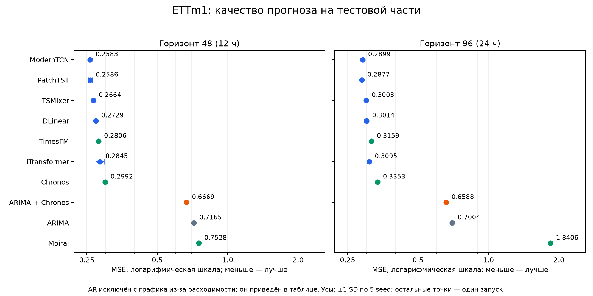
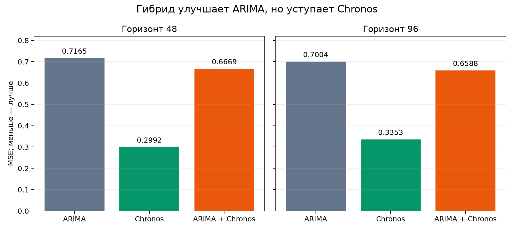

# ETTm1: результаты для обсуждения с преподавателем

Дата подготовки: 29.10.2026.

## Что исследовали

Проверили качество статистических моделей, обучаемых нейросетей и замороженных фундаментальных моделей на ETTm1. Отдельная гипотеза: прогнозирование остатков ARIMA с помощью Chronos улучшает качество относительно каждой модели по отдельности.

Все итоговые запуски завершены: 10 базовых архитектур и один гибрид, 62 строки метрик model/horizon/seed. Это предварительный результат на одном датасете, а не подтверждение точного воспроизведения всех экспериментов преподавателя.

## Протокол

ETTm1: 57 600 наблюдений, 7 каналов, интервал 15 минут. Хронологические части: train [0,34560), validation [34560,46080), test [46080,57600). Контекст 336 точек (84 часа), горизонты 48 и 96 (12 и 24 часа). Тестовые окна со сдвигом 1: 11 473 и 11 425 начал прогноза соответственно. Параметры выбираются по validation.

Масштабирование по среднему и стандартному отклонению только train, отдельно для каждого канала. Таблица показывает MSE/MAE в стандартизованной шкале; меньше — лучше. У DLinear, TSMixer, ModernTCN, PatchTST и iTransformer — среднее ± выборочное SD по пяти seed (0–4). У остальных моделей — один запуск. SD не является доверительным интервалом.

Фундаментальные модели не дообучались. Checkpoint: amazon/chronos-bolt-tiny, google/timesfm-2.5-200m-pytorch, Salesforce/moirai-1.1-R-small. Зафиксированные версии моделей и параметры находятся в артефактах исходных запусков.

## Сравнительная таблица

| Модель | MSE, H=48 | MAE, H=48 | MSE, H=96 | MAE, H=96 |
|---|---|---|---|---|
| AR ⚠ | 1.014e+13 | 3.398e+03 | 1.393e+34 | 8.532e+13 |
| ARIMA | 0.7165 | 0.5307 | 0.7004 | 0.5395 |
| DLinear | 0.2729 ± 0.0012 | 0.3257 ± 0.0012 | 0.3014 ± 0.0006 | 0.3431 ± 0.0005 |
| TSMixer | 0.2664 ± 0.0015 | 0.3325 ± 0.0015 | 0.3003 ± 0.0028 | 0.3554 ± 0.0022 |
| ModernTCN | 0.2583 ± 0.0012 | 0.3227 ± 0.0014 | 0.2899 ± 0.0019 | 0.3443 ± 0.0011 |
| PatchTST | 0.2586 ± 0.0048 | 0.3196 ± 0.0025 | 0.2877 ± 0.0024 | 0.3400 ± 0.0029 |
| iTransformer | 0.2845 ± 0.0115 | 0.3400 ± 0.0035 | 0.3095 ± 0.0047 | 0.3598 ± 0.0034 |
| TimesFM | 0.2806 | 0.3115 | 0.3159 | 0.3354 |
| Chronos | 0.2992 | 0.3145 | 0.3353 | 0.3406 |
| Moirai | 0.7528 | 0.5270 | 1.8406 | 0.5637 |
| ARIMA + Chronos | 0.6669 | 0.5100 | 0.6588 | 0.5216 |

## Основные выводы

Лучшее среднее MSE: ModernTCN при H=48 (0.2583), PatchTST при H=96 (0.2877). При H=48 PatchTST очень близок к ModernTCN (0.2586); заявлять статистически значимое превосходство по этим средним нельзя.

Лучший наблюдаемый MAE при обоих горизонтах — у TimesFM: 0.3115 и 0.3354. TimesFM также имеет лучшее MSE среди трёх исследованных фундаментальных моделей. Лидер зависит от выбранной метрики.

AR показал численную расходимость на отдельных окнах: MSE порядка 10^13 и 10^34. Такой результат следует показывать как проблему устойчивости текущей реализации базовой модели. Он не позволяет делать общий вывод о непригодности AR.

## Проверка гибридной гипотезы

Прогноз гибрида = прогноз ARIMA + прогноз Chronos на остатках. Для обоих горизонтов выбран ARIMA(2,0,0) из двух кандидатов: (2,1,0) и (2,0,0). Коэффициенты оцениваются на первых 128 точках контекста, следующие 208 обрабатываются причинным фильтром с фиксированными параметрами; эти инновации подаются в Chronos.

Гибрид уменьшил MSE относительно ARIMA на 6.93% при H=48 и 5.94% при H=96. Но его MSE выше, чем у отдельного Chronos, на 122.9% и 96.5% соответственно. Гипотеза о преимуществе простой аддитивной комбинации над обеими базовыми моделями в данном эксперименте не подтвердилась.

При H=48 зарегистрировано 2 768 несошедшихся подгонок ARIMA, при H=96 — 2 762 (около 1.7% подгонок выбранного кандидата на validation и test). Это диагностический счётчик оптимизации, а не число ошибок прогнозов и не показатель точности.

## Ограничения интерпретации

Один датасет и два горизонта. Пять повторов выполнены только для обучаемых нейросетей; значимость различий не проверена. Соседние тестовые окна перекрываются, поэтому их нельзя считать независимыми наблюдениями при проверке значимости.

ARIMA использует ограниченный подбор порядков и короткий fit_prefix; её качество не является результатом исчерпывающей настройки ARIMA. Устойчивость AR требует исправления.

Отдельный Chronos получает 336 исходных значений, а остаточная ветвь — 208 инноваций. Это различие контекстов нужно учитывать при сравнении гибрида. При H=96 Chronos работает за пределами родного горизонта 64 с авторегрессионным продолжением.

Фундаментальные модели обрабатывают каналы по отдельности. Точечные прогнозы получены разными способами: медиана у Chronos, point head у TimesFM, среднее 100 выборок у Moirai. Такие оценки по-разному связаны с MSE и MAE. Возможное пересечение предобучения с ETTm1 отдельно не проверялось.

Базовые модели запускались параллельно, Moirai — в отдельном CPU-окружении. Сохранённые времена не подходят для честного ранжирования скорости архитектур.

## Что показать преподавателю

1. Постановку задачи и схему ARIMA → остатки → Chronos → сумма прогнозов.

2. Протокол: данные, разбиение, контекст, горизонты, метрики и повторы.

3. Полную таблицу всех 11 моделей и график MSE. Не скрывать расходимость AR.

4. Отдельное сравнение ARIMA / Chronos / ARIMA + Chronos с относительными изменениями.

5. Ограничения и следующий шаг: стабилизировать статистическую базу, проверить предсказуемость остатков, подобрать вес поправки только на validation, повторить на втором датасете. Это план следующих экспериментов, не выполненный результат.

## Файлы и происхождение результатов

- `index.html` — автономный отчёт с встроенными графиками; можно отправить одним файлом.
- `summary.csv` — сводная таблица; `summary_excel.csv` — вариант с `;` и десятичной запятой.
- `data/metrics.csv` — все 62 строки исходных метрик, включая raw-шкалу.
- `data/manifest.json` — девять исходных завершённых запусков и их идентификаторы.
- `data/selection.json` — выбранные параметры.
- PNG/SVG — графики для слайдов. `build_report.py` повторно строит отчёт из сохранённых CSV.

ARIMA и Chronos взяты из совместного трёхмодельного эксперимента 20261028T221119Z-ab32cd3e; остальные модели — из завершённых индивидуальных запусков. Совместимость данных, разбиений, контекстов и начал прогноза проверена при объединении. Старые неудачные попытки обучения не включены. Новое обучение при подготовке отчёта не запускалось.
