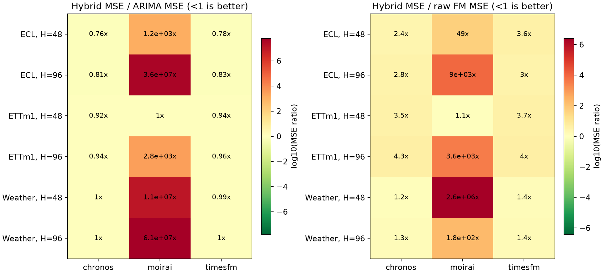
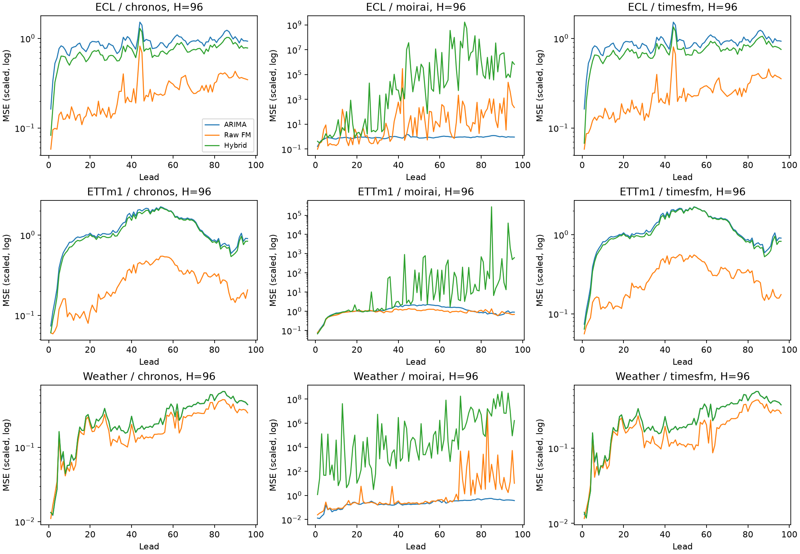
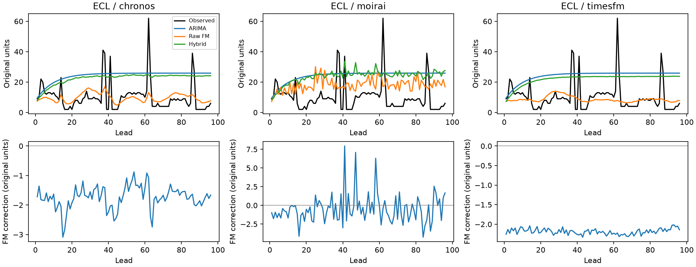
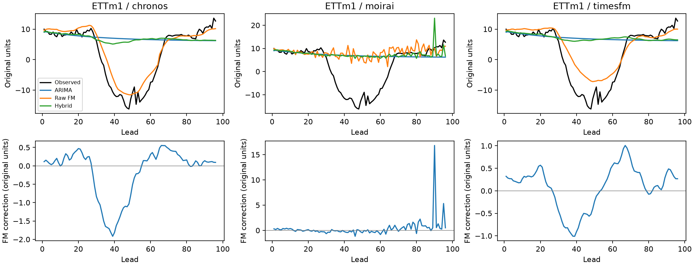
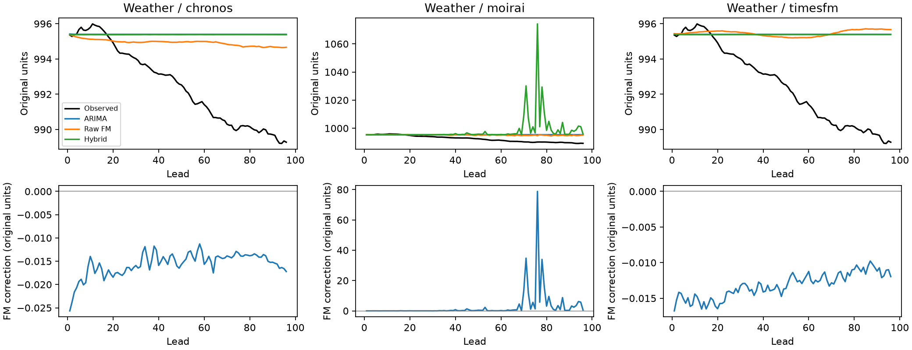

# Пункты 5 и 6: гибрид и первый отчёт (2026-10-26)

Выполнено 18 сравнений на 3 датасетах для 3 FM. Гибрид улучшил ARIMA по MSE в 10 случаях, FM на исходном ряде — в 0, обе компоненты — в 0. Это описательные результаты выбранной подвыборки, не проверка статистической значимости.

## Протокол

Общий протокол common: контекст исходного ряда 336, H=48/96, test origins: 16. Настройки ARIMA выбираются по validation MSE. Параметры фиксируются по первым 128 точкам каждого контекста, затем обновляется состояние без refit. FM получает L-W причинных одношаговых остатков. Итог = база + коррекция с весом 1. Ни критерий выбора, ни вес коррекции по test не подбирались. Точный конфиг каждого запуска сохранён в provenance/.

| dataset | steps | channels | frequency | train | validation | test | seasonality |
| --- | --- | --- | --- | --- | --- | --- | --- |
| ETTm1 | 57600 | 7 | 15min | 34560 | 11520 | 11520 | 96 |
| Weather | 52696 | 21 | 10min | 36887 | 5270 | 10539 | 144 |
| ECL | 26304 | 16 | 1h | 18412 | 2632 | 5260 | 24 |

## MSE и выигрыш

| dataset | horizon | fm | base_mse | fm_mse | hybrid_mse | mse_gain_vs_base_pct | mse_gain_vs_fm_pct |
| --- | --- | --- | --- | --- | --- | --- | --- |
| ECL | 48 | chronos | 0.832459 | 0.263948 | 0.634718 | 23.7538 | -140.471 |
| ECL | 48 | moirai | 0.832459 | 20.3524 | 988.4 | -118633 | -4756.42 |
| ECL | 48 | timesfm | 0.832459 | 0.180829 | 0.649209 | 22.013 | -259.019 |
| ECL | 96 | chronos | 0.889622 | 0.252772 | 0.716424 | 19.4687 | -183.427 |
| ECL | 96 | moirai | 0.889622 | 3534.53 | 3.17387e+07 | -3.56766e+09 | -897859 |
| ECL | 96 | timesfm | 0.889622 | 0.245461 | 0.736674 | 17.1924 | -200.118 |
| ETTm1 | 48 | chronos | 0.773235 | 0.204586 | 0.713966 | 7.66512 | -248.981 |
| ETTm1 | 48 | moirai | 0.77324 | 0.693653 | 0.778177 | -0.638454 | -12.1853 |
| ETTm1 | 48 | timesfm | 0.773235 | 0.197494 | 0.724823 | 6.26096 | -267.01 |
| ETTm1 | 96 | chronos | 1.23072 | 0.26936 | 1.15923 | 5.80829 | -330.366 |
| ETTm1 | 96 | moirai | 1.2307 | 0.946503 | 3388.57 | -275236 | -357909 |
| ETTm1 | 96 | timesfm | 1.23072 | 0.292943 | 1.17586 | 4.45761 | -301.394 |
| Weather | 48 | chronos | 0.122477 | 0.105679 | 0.122041 | 0.355952 | -15.4826 |
| Weather | 48 | moirai | 0.122474 | 0.500165 | 1.29078e+06 | -1.05392e+09 | -2.58071e+08 |
| Weather | 48 | timesfm | 0.122477 | 0.0894562 | 0.120823 | 1.34985 | -35.0643 |
| Weather | 96 | chronos | 0.268654 | 0.206767 | 0.26985 | -0.444898 | -30.5091 |
| Weather | 96 | moirai | 0.268656 | 92286.5 | 1.65128e+07 | -6.14647e+09 | -17793 |
| Weather | 96 | timesfm | 0.268654 | 0.187914 | 0.269123 | -0.174236 | -43.216 |

Положительный gain (%) означает снижение ошибки гибридом.

## Полные результаты

[comparisons.csv](comparisons.csv): MSE/MAE/MASE, интервалы, время и доли выигравших origins. [by_origin.csv](by_origin.csv), [by_channel.csv](by_channel.csv), [by_lead.csv](by_lead.csv). [selected_models.csv](selected_models.csv): выбранные настройки и checkpoints.

## Стоимость

Prediction time включает подгонку локальной ARIMA и FM inference, но не запись Parquet. Память — RSS всего процесса, включая cached модели, не VRAM. Cold load, validation selection и inference нельзя складывать без уточнения режима; метрики затрат здесь диагностические.

## Диагностика ARIMA

Инициализация ARIMA: approximate_diffuse, maxiter=100 в этих конфигах. Approximate diffuse явно задана после LU-сбоя стационарной инициализации на Weather. Численно неудачные validation-кандидаты записываются в selection.json; ошибка выбранной модели на test делает прогон неполным. Часть локальных fit может завершаться без сходимости оптимизатора: такие прогнозы сохранены, а счётчики приведены ниже. Это ограничивает надёжность ARIMA baseline и выводов о её улучшении. Счётчики относятся к выбранному порядку на validation+test, не ко всем кандидатам.

| dataset | horizon | fm | base_fits_validation_test | base_nonconverged_fits | hybrid_nonconverged_fits |
| --- | --- | --- | --- | --- | --- |
| ECL | 48 | chronos | 512 | 3 | 3 |
| ECL | 48 | moirai | 512 | 4 | 4 |
| ECL | 48 | timesfm | 512 | 3 | 3 |
| ECL | 96 | chronos | 512 | 2 | 2 |
| ECL | 96 | moirai | 512 | 1 | 1 |
| ECL | 96 | timesfm | 512 | 2 | 2 |
| ETTm1 | 48 | chronos | 224 | 2 | 2 |
| ETTm1 | 48 | moirai | 224 | 4 | 4 |
| ETTm1 | 48 | timesfm | 224 | 2 | 2 |
| ETTm1 | 96 | chronos | 224 | 5 | 5 |
| ETTm1 | 96 | moirai | 224 | 6 | 6 |
| ETTm1 | 96 | timesfm | 224 | 5 | 5 |
| Weather | 48 | chronos | 672 | 161 | 161 |
| Weather | 48 | moirai | 672 | 155 | 155 |
| Weather | 48 | timesfm | 672 | 161 | 161 |
| Weather | 96 | chronos | 672 | 145 | 145 |
| Weather | 96 | moirai | 672 | 138 | 138 |
| Weather | 96 | timesfm | 672 | 145 | 145 |

## Ограничения

Все результаты получены на CPU. Electricity ограничен фиксированными 16 каналами; origins выбраны равномерно по split, а не исчерпывают весь test. Это расширенный pilot. Каналы и соседние ошибки не являются независимыми наблюдениями; доля выигравших origins описательная, без p-value. FM используют разные point forecasts (Chronos: медиана; TimesFM: native head; Moirai: среднее samples). Интервалы гибрида условны на point базы. Для H=96 Chronos-Bolt использует rollout сверх native H=64. Moirai запускается в отдельном окружении со своим paired ARIMA baseline. Pretraining overlap не проверен. ARIMA ограничена двумя порядками и fit-prefix=128; сравнение не охватывает все ARIMA/SARIMA-настройки. Результаты общего протокола не воспроизводят таблицы FM-статей.

## Ранее выполненный контроль DLinear

| dataset | horizon | expected_mse | actual_mse | difference | status |
| --- | --- | --- | --- | --- | --- |
| ETTm1 | 48 | 0.27028 | 0.27028 | -7.25301e-09 | within_tolerance |

Сопоставление с авторским логом одного seed, не полная репликация Table 2 или FM-статей.

## Moirai: среднее и медиана

В основной таблице Moirai использует среднее 100 samples, как задано до запуска. В отдельных прогнозах среднее значительно выходит за центральный 80% интервал и даёт крупные ошибки. Ниже отдельно пересчитаны ошибки сохранённой q0.5 без нового inference и изменения основного результата. Это post-hoc диагностика чувствительности к точечному функционалу, не выбор модели по test. Крупнейшие ошибки и их квантили сохранены в largest_errors.csv; примеры выбраны именно для диагностики выбросов.

| dataset | fm | horizon | seed | role | mean_mse | median_mse | mean_mae | median_mae | max_abs_mean_error_scaled | max_abs_median_error_scaled |
| --- | --- | --- | --- | --- | --- | --- | --- | --- | --- | --- |
| ETTm1 | moirai | 48 | 0 | fm | 0.693653 | 0.724197 | 0.5043 | 0.505082 | 5.16879 | 5.26514 |
| ETTm1 | moirai | 48 | 0 | hybrid | 0.778177 | 0.793332 | 0.579096 | 0.582344 | 5.3182 | 4.19927 |
| ETTm1 | moirai | 96 | 0 | fm | 0.946503 | 0.929902 | 0.594552 | 0.57316 | 6.55525 | 5.2606 |
| ETTm1 | moirai | 96 | 0 | hybrid | 3388.57 | 1.19581 | 2.08237 | 0.623474 | 5531.46 | 6.37068 |
| Weather | moirai | 48 | 0 | fm | 0.500165 | 0.110681 | 0.220113 | 0.163016 | 43.7764 | 5.69539 |
| Weather | moirai | 48 | 0 | hybrid | 1.29078e+06 | 0.128892 | 27.9879 | 0.17312 | 108193 | 5.73133 |
| Weather | moirai | 96 | 0 | fm | 92286.5 | 0.224543 | 2.25374 | 0.229311 | 54495.1 | 5.6957 |
| Weather | moirai | 96 | 0 | hybrid | 1.65128e+07 | 0.282263 | 111.247 | 0.259174 | 380652 | 6.90959 |
| ECL | moirai | 48 | 0 | fm | 20.3524 | 0.312976 | 0.454822 | 0.332843 | 340.574 | 12.2087 |
| ECL | moirai | 48 | 0 | hybrid | 988.4 | 0.770328 | 1.53889 | 0.676808 | 2702.91 | 12.2233 |
| ECL | moirai | 96 | 0 | fm | 3534.53 | 0.321821 | 1.35424 | 0.34675 | 8759.32 | 12.2229 |
| ECL | moirai | 96 | 0 | hybrid | 3.17387e+07 | 0.83736 | 117.441 | 0.711189 | 651674 | 12.247 |



Отношение MSE гибрида к референсу: меньше 1 означает улучшение; цвет — log10 отношения.



MSE по шагам прогноза, H=96; все выбранные каналы и origins.



ECL: первый origin и первый канал, выбранные до анализа ошибок.



ETTm1: первый origin и первый канал, выбранные до анализа ошибок.



Weather: первый origin и первый канал, выбранные до анализа ошибок.

## Как повторить

```powershell
.\.venv\Scripts\python.exe -m tshybrid run configs/hybrid_core.yaml
.\.venv-moirai\Scripts\python.exe -m tshybrid run configs/hybrid_moirai.yaml
.\.venv\Scripts\python.exe -m tshybrid hybrid-report outputs/<core-id> outputs/<moirai-id> --output reports/<new-study> --reproduction reports/reproduction
```

Сначала завершить основной запуск, затем Moirai, чтобы не конкурировать за CPU.

Полные прогнозы находятся в outputs/<run-id>/. В отчёте хранятся компактные примеры и сводки; перед расчётом проверены одинаковые targets, совпадение базы и сумма base+correction.
